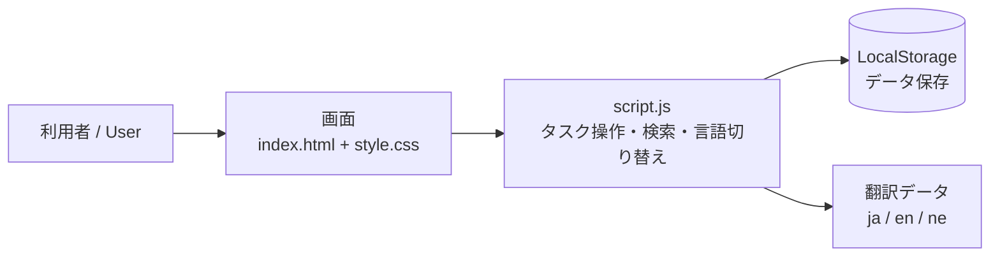

# Sports Task Manager | スポーツタスクマネージャー

練習・試合・トレーニングの予定を管理する、シンプルなタスク管理 Web アプリです。日本語・英語・ネパール語を画面上で切り替えられます。

A simple web app for managing practice sessions, matches and training. The interface switches between Japanese, English and Nepali.


---

## 機能 / Features

| 機能 / Feature | 内容 / Details |
|---|---|
| ✏️ タスク管理 / Tasks | 追加、編集、完了・再開、削除 / add, edit, complete or reopen, delete |
| 🔍 検索 / Search | キーワードですぐに絞り込み / instant search |
| 🗂️ フィルター / Filter | すべて・未完了・完了 / all, active, completed |
| 📊 統計 / Stats | タスクの件数と進み具合を表示 / task counts and progress |
| 🌐 多言語 / Languages | 🇯🇵 日本語　🇬🇧 English　🇳🇵 नेपाली |
| 💾 保存 / Storage | ブラウザの LocalStorage に保存。サーバーは不要 / saved in LocalStorage, no server needed |

---

## しくみ / How it works



言語の切り替えは、JavaScript の翻訳データから表示文言を差し替える方式です。React や Vue などのフレームワークは使わず、JavaScript の基本（DOM 操作、イベント処理）で作りました。

Language switching swaps the on-screen text from a translation object in JavaScript. No framework is used; it is built on plain DOM manipulation and event handling.

---

## 使い方 / How to run

```bash
git clone https://github.com/amishanita/sports-task-manager.git
cd sports-task-manager
```

`index.html` をブラウザで開くだけで動きます。インストールは不要です。

Open `index.html` in a browser. No install needed.

---

## フォルダ構成 / Structure

```
sports-task-manager/
├── index.html   画面の構成 / layout
├── style.css    デザイン / styling
├── script.js    動作 / app logic
└── README.md
```

---

**Tamang Amish**　|　[GitHub](https://github.com/amishanita)　|　[LinkedIn](https://www.linkedin.com/in/tamang-amish-669289250)
